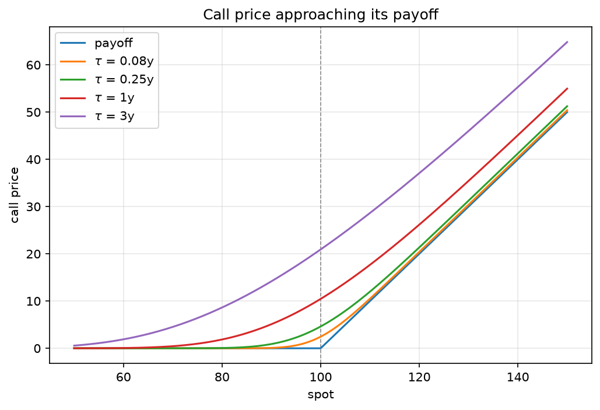
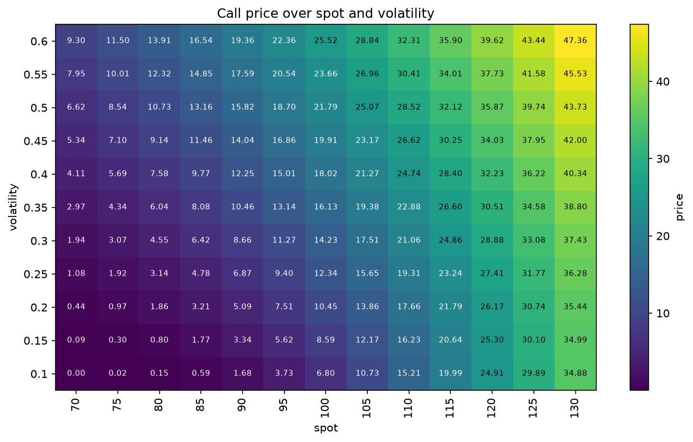
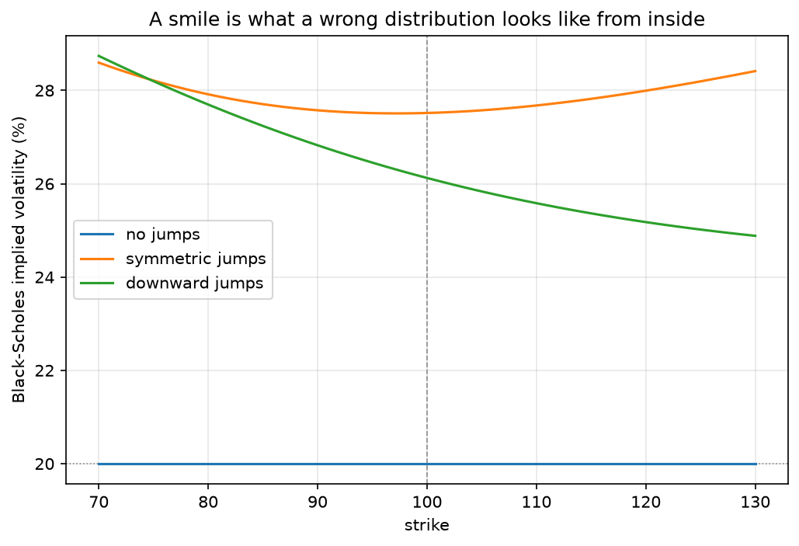

```{pyodide}
#| autorun: true
#| edit: false
#| caption: "Install the package into the browser runtime"
import micropip
await micropip.install("bsm-pricer==0.1.0")

from bsm import (
    Contract, Market, OptionKind,
    price, greeks, implied_volatility, price_surface,
    call_price, put_price, price_bounds,
    JumpParameters, jump_price, volatility_smile,
)
import numpy as np
```

::: {.callout-note appearance="simple"}
Every code cell on this page is live. The cell above installs `bsm-pricer` from PyPI into
a Python runtime running in your browser; everything below then runs against it. Nothing
is sent anywhere and nothing was precomputed. Edit a number and press run.

The runtime takes several seconds to load the first time, so the figures and prose are
static and readable immediately. The install is shown rather than hidden deliberately: a
failure there is the only thing that can break the rest of the page, and it should be
visible when it happens rather than surfacing as a puzzling error further down.
:::

## What the model says

An option is a right without an obligation. A European call struck at $K$ gives its
holder the right to buy one unit of some underlying asset at time $T$ for the price $K$,
whatever the asset is worth by then. If the asset ends up above the strike, the holder
exercises and pockets the difference; if below, the right expires unused. The payoff is
$\max(S_T - K, 0)$, a hockey stick with its kink at the strike.

The question Black, Scholes and Merton answered in 1973 is what that right is worth
today. Their answer is remarkable less for the formula than for the argument behind it.
They observed that an option's risk can be cancelled by holding an offsetting position in
the underlying, and that the offsetting position can be adjusted continuously as the
price moves. A portfolio hedged this way carries no risk at all, so it must earn the
risk-free rate — otherwise there would be free money on the table. That single
observation pins the price down completely, and it does so without anyone needing to
state what return they expect the asset to earn. The expected return does not appear in
the formula. This is the part that still surprises people.

The model assumes the asset price follows geometric Brownian motion with constant
volatility $\sigma$ and constant risk-free rate $r$, that trading is continuous and
frictionless, and that the asset pays a continuous dividend yield $q$. Under those
assumptions the call price is

$$
C = S e^{-q\tau}\,\Phi(d_1) - K e^{-r\tau}\,\Phi(d_2),
$$

$$
d_1 = \frac{\ln(S/K) + (r - q + \sigma^2/2)\,\tau}{\sigma\sqrt{\tau}},
\qquad d_2 = d_1 - \sigma\sqrt{\tau},
$$

where $\tau$ is the time remaining, $\Phi$ is the standard normal distribution function,
and the put follows by symmetry.

The two terms have readings. $Ke^{-r\tau}\Phi(d_2)$ is the strike, discounted, weighted by
the risk-neutral probability that the option finishes in the money. $Se^{-q\tau}\Phi(d_1)$
is the asset, discounted for dividends, weighted by something that looks like a
probability but is not one — it is the probability under a measure that reweights outcomes
by the asset's own value. The difference between $\Phi(d_1)$ and $\Phi(d_2)$ is entirely
this change of measure.

```{pyodide}
#| caption: "Price a European option"
contract = Contract(strike=100.0, maturity=1.0, kind=OptionKind.CALL)
market = Market(spot=100.0, rate=0.05, volatility=0.20)

price(contract, market)
```

Try raising the volatility to `0.40` and running it again. The price goes up, and it goes
up for both calls and puts. That is worth pausing on, because it is not obvious: more
uncertainty makes an option *more* valuable regardless of direction. The reason is the
kink. Losses are truncated at zero — the holder simply declines to exercise — while gains
are not. Widening the distribution adds to the unbounded side and nothing to the bounded
one.

## Parity, and what it forces

Two portfolios that pay the same thing must cost the same thing. Hold a call and sell a
put, both struck at $K$: if the asset finishes above the strike you exercise the call, if
below the put is exercised against you, and either way you end up holding the asset having
paid $K$. That is a forward contract. So

$$
C - P = S e^{-q\tau} - K e^{-r\tau},
$$

which is put-call parity. It is not a result of the Black-Scholes model. It follows from
arbitrage alone and holds for market prices, for prices from any model, and for prices
someone made up, provided they are consistent.

```{pyodide}
#| caption: "Parity holds to rounding"
terms = (100.0, 100.0, 0.05, 0.0, 1.0, 0.20)
call = call_price(*terms)
put = put_price(*terms)

left = call - put
right = 100.0 - 100.0 * np.exp(-0.05)
left, right, abs(left - right)
```

Parity has a use beyond bookkeeping: it makes the pricing code checkable. The package
computes the put directly rather than deriving it from the call, so parity is an
independent test of two expressions rather than an identity the code imposes on itself.
The same reasoning gives the no-arbitrage bounds. A call is worth at least the discounted
intrinsic value on the forward and never more than the (dividend-discounted) asset:

$$
\max\!\left(S e^{-q\tau} - K e^{-r\tau},\ 0\right) \le C \le S e^{-q\tau}.
$$

The lower bound is attained at zero volatility. The upper is approached as volatility
grows without bound and never reached.

```{pyodide}
#| caption: "The price lives strictly inside its bounds"
lower, upper = price_bounds(OptionKind.CALL, 100.0, 100.0, 0.05, 0.0, 1.0)
lower, call_price(*terms), upper
```

## The sensitivities

A price on its own is of limited use. What a position holder needs to know is how the
price moves when the world does, and those derivatives — the Greeks — are what the hedging
argument was about in the first place.

**Delta**, $\partial V/\partial S$, is the hedge ratio: the number of units of the
underlying that cancels the option's first-order exposure. It runs from 0 to $e^{-q\tau}$
for a call, and it is the quantity the original derivation continuously rebalances.

**Gamma**, $\partial^2 V/\partial S^2$, is how fast delta itself moves. It is why the hedge
has to be rebalanced at all, and why the argument needs continuous trading to be exact. It
peaks near the money and decays in both directions.

**Vega**, $\partial V/\partial\sigma$, is sensitivity to volatility. It is strictly positive
for any option with time and volatility left, which is the fact that makes the next section
possible — and it vanishes far from the money, which is what makes that section delicate.
Note that vega is not a Greek letter.

**Theta**, $\partial V/\partial t$, is the cost of time passing. It is usually negative for
a long position: an option is a wasting asset, and the waiting is what you pay for.

**Rho**, $\partial V/\partial r$, is sensitivity to the risk-free rate. Small in most
regimes, which is why it is usually listed last.

```{pyodide}
#| caption: "All five sensitivities"
result = greeks(contract, market)

{
    "delta": round(result.delta, 4),
    "gamma": round(result.gamma, 4),
    "vega per point": round(result.vega / 100, 4),
    "theta per day": round(result.theta / 365, 4),
    "rho per bp": round(result.rho / 10_000, 6),
}
```

The division by 100, 365 and 10,000 is a quoting convention, not part of the mathematics.
The library returns raw derivatives — per unit of volatility, per year, per unit of rate —
because rescaling inside the library would break the identities that hold between the
Greeks. Rescaling belongs at the point of display.

{#fig-curves}

@fig-curves is worth reading slowly. Each curve is the price at a different time to
maturity, and the sequence shows what theta actually does. Far from expiry the curve is
smooth and sits well above the payoff; as time runs out it presses down onto the hockey
stick. The gap between a curve and the payoff is the time value, and it is what the holder
of a long position loses, day by day, for nothing.

## Running the model backwards

Here the argument turns. Every quantity in the formula is observable except one: nobody
can look up $\sigma$. Volatility is not a price, it is a parameter, and the market does not
quote it.

But option prices *are* quoted. So the question can be inverted. Given a price someone is
actually willing to trade at, what volatility would the Black-Scholes formula need in order
to produce it? That number is the **implied volatility**, and it has become the standard
way options are quoted — traders talk in volatility points, not in currency.

The inversion is well posed for a specific reason: vega is strictly positive, so the price
is a strictly increasing continuous function of $\sigma$, running from the lower
no-arbitrage bound at $\sigma = 0$ up toward the upper bound as $\sigma \to \infty$. A
price strictly inside those bounds therefore has exactly one implied volatility. A price
outside has none, and the right response is to say so rather than to return a number.

```{pyodide}
#| caption: "Recover the volatility from a price"
observed = call_price(100.0, 100.0, 0.05, 0.0, 1.0, 0.35)

recovered = implied_volatility(
    observed, OptionKind.CALL, 100.0, 100.0, 0.05, 0.0, 1.0
)
observed, recovered
```

The package solves this with Brent's method on the bracket the no-arbitrage bounds supply
for free. The obvious alternative, Newton's method, needs no bracket but divides by vega —
and vega vanishes for deep in- and out-of-the-money options, which are exactly the quotes
where implied volatility is most often wanted and least well determined. A bracketing
method cannot diverge; a Newton iteration on a near-flat function can go anywhere.

There is a limit worth being honest about. Uniqueness is a statement about real numbers.
A far out-of-the-money option at low volatility can be worth less than the smallest
positive double, in which case its computed price is exactly zero, indistinguishable from
its price at zero volatility. Nothing can recover the input from that, because the forward
computation destroyed it. Vega is the diagnostic: where it is negligible, the implied
volatility is poorly determined however it was obtained.

```{pyodide}
#| caption: "A price no volatility can produce"
try:
    implied_volatility(101.0, OptionKind.CALL, 100.0, 100.0, 0.05, 0.0, 1.0)
except ValueError as error:
    print(f"{type(error).__name__}: {error}")
```

## Two dimensions at once

Sensitivities describe behaviour at a point. To see the shape of the model you need a
surface — the price over a grid of spot prices and volatilities, holding the contract
terms fixed.

{#fig-heatmap}

@fig-heatmap makes several things visible at once. The steepness of the left-to-right
gradient *is* delta, and its variation across the row is gamma. The vertical gradient is
vega, and it is clearly largest near the middle column — near the money — and compressed at
the edges. The bottom-left corner, where the option is out of the money and volatility is
low, is nearly flat: that is the region where the inverse problem above becomes ill
conditioned.

```{pyodide}
#| caption: "Build your own surface"
grid = price_surface(
    OptionKind.CALL,
    volatilities=np.linspace(0.1, 0.5, 5),
    spots=np.linspace(80.0, 120.0, 5),
    strike=100.0,
    rate=0.05,
    dividend_yield=0.0,
    maturity=1.0,
)
np.round(grid.values, 2)
```

## Where it stops working

Everything above is internally consistent. The question is whether it describes the world,
and the model itself supplies the test.

Implied volatility is defined by inverting Black-Scholes at a quoted price. If the model
were correct, every option on the same underlying with the same expiry would imply the same
$\sigma$ — there is only one volatility parameter, and it belongs to the asset, not to the
contract. Implied volatility plotted against strike would be a horizontal line.

It is not. Since the crash of October 1987, equity index options have shown implied
volatility that rises as strike falls, sometimes steeply — the volatility **skew**, or
**smile** where it curves upward at both ends. The pattern is stable, well documented, and
completely incompatible with the assumption that produced it.

What it says is that the market does not believe returns are lognormal. Out-of-the-money
puts trade richer than the model says they should, which means participants assign more
probability to a large downward move than a normal distribution allows. The model is being
used as a quotation convention while its central assumption is being priced against.

That is not a defect in the arithmetic. It is the model being informative about its own
limits — the formula is exact given its assumptions, and the smile is the market saying
which assumption is wrong.

## Manufacturing a smile

The claim can be tested rather than asserted, and the way to test it is to build a world
where the answer is known in advance.

Merton's 1976 extension keeps everything about Black-Scholes except continuity. Alongside
the diffusion, jumps arrive as a Poisson process with intensity $\lambda$, and each
multiplies the price by a lognormal factor. The model still has a closed form, and the
form is the useful part: conditional on exactly $n$ jumps, the terminal distribution is
lognormal again — wider, and differently centred — so the price given $n$ is a
Black-Scholes price. The unconditional price is a Poisson-weighted average of them:

$$
C = \sum_{n=0}^{\infty}
    \frac{e^{-\lambda'\tau}(\lambda'\tau)^n}{n!}\,
    C_{\mathrm{BS}}(S, K, r_n, q, \tau, \sigma_n),
$$

with $\sigma_n^2 = \sigma^2 + n\delta^2/\tau$ and a drift $r_n$ carrying a compensator
that cancels the average jump, so the discounted price stays a martingale.

Returns under this model are not lognormal — a mixture of lognormals is not one — so it is
exactly the situation the previous section described, except that here we know the truth
because we generated it.

```{pyodide}
#| caption: "Price with jumps, then read it back through Black-Scholes"
jumps = JumpParameters(intensity=1.0, mean=-0.10, volatility=0.15)

generated = jump_price(OptionKind.CALL, 100.0, 100.0, 0.05, 0.0, 1.0, 0.20, jumps)
implied = implied_volatility(
    generated, OptionKind.CALL, 100.0, 100.0, 0.05, 0.0, 1.0
)
round(generated, 4), round(implied, 4)
```

The price was produced with a diffusion volatility of 0.20, and Black-Scholes reads it
back as something higher. That much is unsurprising: the jumps add variance, and the only
place the inverting model can put it is $\sigma$.

The interesting part is what happens across strikes.

```{pyodide}
#| caption: "The smile, one strike at a time"
strikes = np.array([80.0, 90.0, 100.0, 110.0, 120.0])

np.round(100 * volatility_smile(
    strikes, spot=100.0, rate=0.05, dividend_yield=0.0,
    maturity=1.0, volatility=0.20, jumps=jumps,
), 2)
```

Not constant. One underlying, one expiry, one generating process — and five different
implied volatilities, falling as the strike rises. That is a skew, and nothing about it is
noise or numerical error: the prices are exact to the last few digits and the inversions
round-trip.

{#fig-smile}

@fig-smile is the argument in one picture, and the flat line is the part that makes it an
argument rather than an anecdote. Without the control, a curved line would prove nothing —
it could be a bug in the solver, or in the pricer, or in the plot. With it, the same
pipeline that returns a constant 20% when the assumption holds returns a curve when it
does not.

The two curved lines differ in a way that is worth reading. Symmetric jumps — as likely up
as down — produce a genuine smile, turning up at both ends and lowest near the money.
Downward-biased jumps tilt it into a monotone skew: the left side rises and the right side
falls, because the extra probability mass has been put on one side of the distribution
only. The shape encodes *which* way the generating distribution departs from lognormal,
not merely that it does.

```{pyodide}
#| caption: "Change the jumps, change the shape"
symmetric = JumpParameters(intensity=1.0, mean=0.0, volatility=0.20)

np.round(100 * volatility_smile(
    strikes, spot=100.0, rate=0.05, dividend_yield=0.0,
    maturity=1.0, volatility=0.20, jumps=symmetric,
), 2)
```

Set `mean=0.0` and the curve becomes roughly symmetric about the money. Push it negative
and the left side lifts. Set `intensity=0.0` and it flattens to exactly 20% everywhere,
because at that point the generating model and the inverting model are the same model.

### What this does and does not establish

It establishes a mechanism. If prices are generated by a process whose returns are not
lognormal, and you invert them through a model that assumes they are, implied volatility
varies with strike, and the pattern of variation reflects the shape of the real
distribution. That is a statement about the inversion, and it is demonstrated here rather
than argued.

It does not establish that jumps are why equity index options exhibit a skew. Stochastic
volatility produces a similar shape by a different route, and so do several other
departures from the assumptions; distinguishing between them is an empirical question this
page does not touch, and answering it would require market data rather than a generated
example. The honest conclusion is narrower and still worth having: a smile is what a wrong
distributional assumption looks like from the inside, and Black-Scholes is precise enough
about its assumptions to make its own failure legible.

## Colophon

The `bsm` package is typed, tested, and free of SciPy: the normal distribution function is
Hart's algorithm and the root-finder is Brent's method, both implemented in the package and
both pinned in the test suite against oracles — `math.erfc` for the distribution,
`scipy.optimize.brentq` for the solver, and a 50-digit `mpmath` evaluation for the prices
themselves. That is what makes this page possible: the whole library loads into your
browser in a few seconds, and the code that ran above is the code the tests run.
